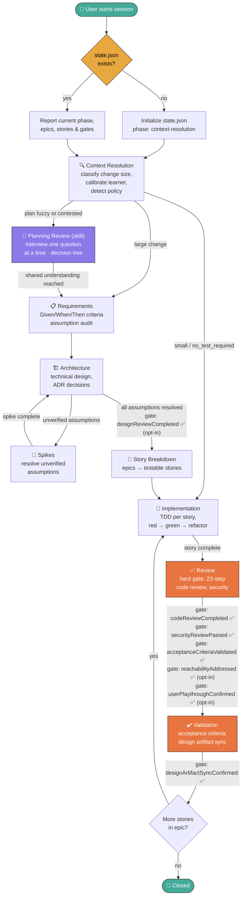

# Cadet-Agent

Cadet-Agent is an **opinionated** cross-IDE agent framework for game-development workflows. It is built on foundational software engineering practices and real-world game-development experience, with the goal of **guiding you through the entire development process** — from requirements and technical design through TDD, implementation, and review.

Cadet-Agent is **not a one-shot code generator**. It won't spit out a finished game from a single prompt. Instead, it walks you through each phase methodically: calibrating the learner model, scoping work into epics and stories, planning architecture, writing tests first, and iterating on feedback. The shared framework core integrates with GitHub Copilot, Cursor, Continue, Claude Code, Deep Code, and Hermes, and it drives one engine at a time through an **engine pack** — a set of commands and conventions for **Unity** or **Unreal** that the phase skills defer to.

## Repository Layout
- `.cadet/agent/core/` contains the shared Cadet-Agent framework documents.
  - `cadet-agent.md` is the thin global directive: identity, non-negotiable rules, workflow routing, hard-gate protocol, and skill dispatch.
  - `HarnessRuntime.md` is the lean runtime contract; `Harness.md` keeps the full harness rationale and reference.
  - `harness.schema.json` and `state.schema.json` are the machine-readable schemas for harness records and session state.
  - `skills/` contains scoped workflow-phase skills (PlanningReview, Requirements, Architecture, DesignReview, Spike, StoryBreakdown, TDD, Debugging, CodeReview, VisualEvidence, Resume, MCPSetup, AgentReviewer, Handoff, Reconciliation).
  - `templates/` contains runtime templates for planning artifacts.
  - `engines/unity/` and `engines/unreal/` are the engine packs: the commands and conventions each engine needs, read through `.cadet/engine.json`.
- `.cadet/harness.json` holds repository-local budget/policy overrides (preserved by sync).
- `.cadet/runs/` holds sanitized run ledgers (preserved by sync; no secrets or raw prompts by default).
- `src/harness/` contains the harness implementation (policy, budget, state, verification, context, routing, redaction, ledger, archive, hook, C# scan and diagram generation). Its one runtime dependency is `nomnoml`, the UML renderer used by `harness diagram` — see [Component diagrams](#component-diagrams).
- `.cadet/agent/docs/` contains setup guides for each supported IDE.
- `.github/agents/` contains the Copilot custom agent definitions (Cadet Agent + Cadet Agent Reviewer).
- `.github/prompts/` contains Copilot slash-command skill prompts (`/cadet-review`, `/cadet-tdd`, etc.).
- `.cursor/` contains Cursor-specific authored files.
- `.continue/` contains Continue-specific authored files.
- `.claude/` contains Claude Code-specific authored files.
- `.agents/skills/` contains Deep Code / Hermes (cross-client) skill adapters.
- These IDE folders hold thin integration shims; the core framework logic still lives in `.cadet/agent/core/`.
- `packages/` holds the engine products, one directory each, all at the suite version:
  - `packages/cli/` — the Cadet CLI (`build.sh`, `dist.sh`, `Steam/`, `Epic/`, profile fixtures and schema). This is the only copy.
  - `packages/unity/` — the Unity editor tooling, installed to `Assets/Covyne/Cadet/`. It is copied files, never a UPM package.
  - `packages/unreal/` — the `CadetBuild` plugin, installed to `Plugins/CadetBuild/`.
  - Each package carries a `PROVENANCE.md` naming the commit it came from.
- `components.json` lists every installable component with the zip paths it takes and where it lands, so one archive can install different shapes.
- `test/` holds the node suite (`npm test`) over the framework, the installer, the uninstaller and the engine packages.
- `package-agent.ps1` builds the distributable `cadet-agent.zip` (the installer's payload), the hand-drop `cadet-unreal-<version>.zip`, and writes each engine package's `LICENSE.md` and `CHANGELOG.md` into them at package time.
- `bump-version.ps1` bumps the version in the four files code reads (`package.json`, `FrameworkManifest.json`, `packages/cli/VERSION`, `packages/unreal/CadetBuild.uplugin`), reads all four back, commits, tags, and pushes. It runs `npm run lint` first and refuses to release if the link check fails. Pushing the tag is what publishes the release.
- `npm run lint` checks all markdown links (the same offline check CI runs); `npm run test:cli` runs the CLI's own gate; `npm run verify` runs tests, the CLI gate and lint.

## Cross-IDE Support

Cadet-Agent provides the **same skills** across six IDEs — one canonical file per skill, read through thin per-host pointers. It does **not** provide equal *enforcement*, and it does not claim to: no host here can block what it has no API to intercept, so enforcement is measured per action and published. Run `cadet-agent harness capabilities --verify-host` for the measured matrix on your repository, or read [Host Interception](docs/core/HostInterception.md).

| Feature | GitHub Copilot | Cursor | Continue | Claude Code | Deep Code | Hermes |
|---|---|---|---|---|---|---|
| Auto-load rules | Agent definition | `alwaysApply` rule | Project rule | Project skill | Project skill (`.agents/skills/`) | Project skill (`.agents/skills/`) |
| Skill dispatch | `/cadet-<skill>` prompts | Natural language | `/cadet-<skill>` commands | `/cadet-<skill>` skills | `/skills` menu (`/`) | `/cadet-<skill>` commands |
| Planning Review | ✅ | ✅ | ✅ | ✅ | ✅ | ✅ |
| Requirements | ✅ | ✅ | ✅ | ✅ | ✅ | ✅ |
| Architecture | ✅ | ✅ | ✅ | ✅ | ✅ | ✅ |
| Design Review | ✅ | ✅ | ✅ | ✅ | ✅ | ✅ |
| Spike | ✅ | ✅ | ✅ | ✅ | ✅ | ✅ |
| Story Breakdown | ✅ | ✅ | ✅ | ✅ | ✅ | ✅ |
| TDD | ✅ | ✅ | ✅ | ✅ | ✅ | ✅ |
| Debugging | ✅ | ✅ | ✅ | ✅ | ✅ | ✅ |
| Code Review | ✅ | ✅ | ✅ | ✅ | ✅ | ✅ |
| Visual Evidence | ✅ | ✅ | ✅ | ✅ | ✅ | ✅ |
| Resume | ✅ | ✅ | ✅ | ✅ | ✅ | ✅ |
| MCP Setup | ✅ | ✅ | ✅ | ✅ | ✅ | ✅ |
| Reconciliation | ✅ | ✅ | ✅ | ✅ | ✅ | ✅ |
| Reviewer mode | Agent picker | Rule toggle | `/cadet-agent-reviewer` | `/cadet-agent-reviewer` | `cadet-agent-reviewer` skill | `/cadet-agent-reviewer` |
| Git guard (declared; measured by `--verify-host`) | `native` — PreToolUse hook | `external` via the repository Git hook, else `advisory` | `external` / `advisory` | `advisory` until a hook is configured | `external` (declared: `permissions.ask`) | `external` (declared: approval policies) |

Every other row is a capability: the skills are the same, the interception is not, and the difference is
measured rather than assumed (see [Host Interception](docs/core/HostInterception.md)). The portable control
that works for every host is the repository Git hook: `git config core.hooksPath .githooks`.

All adapters delegate to the canonical files under `.cadet/agent/core/` — no duplicated rules or skills. See `ADAPTERS.md` for the full inventory, `docs/guidance/DeepCode.md` for Deep Code setup, and `docs/guidance/Hermes.md` for Hermes setup.

## Quick Install

```bash
npx cadet-agent@latest init
```

The installer asks three questions — **which hosts**, **which engine**, and **whether to install the plugin** — and writes only what you choose. The framework core is always installed. Every answer has a flag, so the same command works in CI:

```bash
npx cadet-agent@latest init --hosts claude,hermes --engine unity --yes
npx cadet-agent@latest init --target ./my-project --engine unreal --no-plugins
npx cadet-agent@latest init --components core,host.cursor     # name the set outright
```

What each choice installs:

| Choice | Files that land | Where |
|---|---|---|
| Core (always) | `.cadet/agent/` — directive, harness, skills, templates, engine packs | project root |
| `copilot` | agent definitions, slash-command prompts, the git-guard hook | `.github/` |
| `claude` | base, reviewer and per-phase skills | `.claude/skills/` |
| `hermes`, `deepcode` | the same skills, as the cross-client root both hosts read | `.agents/skills/` |
| `cursor` | rule files | `.cursor/rules/` |
| `continue` | rules and command config | `.continue/` |
| `unity` | the editor tooling and the CLI | `Assets/Covyne/Cadet/` and `Assets/Covyne/Cadet/CLI/` |
| `unreal` | the `CadetBuild` plugin and the CLI | `Plugins/CadetBuild/` and `Plugins/CadetBuild/CLI/` |

The engine is detected from the project when you do not say: an `Assets/` folder means Unity, a `.uproject` means Unreal, and a project with both gets both.

Two records are written, and both matter later:

- `.cadet/agent/install.json` — every installed file with its sha256, the components, the engine and the install targets. This is what makes `sync` and `uninstall` exact.
- `.cadet/engine.json` — the engine, its plugin and CLI roots, and the editor version. The phase skills read their commands from it.

### Keeping the Framework Updated

```bash
npx cadet-agent@latest sync
```

`sync` installs exactly the components the record names: a component that is new in the release is reported with the `init` command that would add it, and is not installed. Managed files (`.cadet/agent/core/`, IDE shims, agent definitions) are replaced. Your local policies (`.cadet/agent/policies/`), project plans (`.cadet/agent/project-plans/`), harness overrides (`.cadet/harness.json`), run ledgers (`.cadet/runs/`) and state (`.cadet/state.json`) are preserved. A file you edited after install is reported and left alone. After syncing, start a fresh chat for the changes to take effect.

```bash
npx cadet-agent@latest sync --target ./my-project
```

### Uninstalling

```bash
npx cadet-agent@latest uninstall --dry-run   # show the four lists, delete nothing
npx cadet-agent@latest uninstall
```

`uninstall` removes a file only when its hash still matches the record. A file you edited is kept and named; the paths that hold your own work — policies, plans, state, reports, handoffs, archives — are never touched, even if a corrupt record names them. For Unreal it also removes `Plugins/CadetBuild/Binaries/` and `Intermediate/` by rule, leaves downloaded tools (Cosmos, SteamCMD, BuildPatchTool) in place, names the logs, and says to close the editor and reopen the project. A second run finds no record and exits clean.

#### AGENTS.md is create-only

Cadet ships a repository-root `AGENTS.md` (a thin pointer to `.cadet/agent/core/cadet-agent.md`). If your repo already has one, Cadet **never overwrites it**:

- In a terminal, `init`/`sync` ask whether to keep, overwrite, or merge (default: keep).
- Non-interactive installs (CI, `--yes`, piped output) always **keep** and print a tag-pinned link to Cadet's copy.
- Control it explicitly with `--agents-md keep|overwrite|merge`.
- `merge` inserts Cadet's text between `<!-- cadet-agent:begin -->` / `<!-- cadet-agent:end -->` markers and leaves the rest of your file untouched.

```bash
npx cadet-agent@latest sync --agents-md keep       # never touch an existing AGENTS.md
npx cadet-agent@latest sync --yes                  # non-interactive; keeps existing files
```

## Manual install (when you cannot run the installer)

There is no extract-it-yourself path for the whole suite any more. `cadet-agent.zip` is the installer's payload: a componentised archive that `init` maps to the folders you chose, so extracting it at a project root would land `packages/` and the core in the wrong places. Two supported alternatives exist:

**Unreal, hand drop.** `cadet-unreal-<version>.zip` carries the plugin at its root with the CLI in `CLI/` beside it. Extract it into `Plugins/CadetBuild/`:

```powershell
Expand-Archive .\cadet-unreal-0.64.0.zip -DestinationPath .\Plugins\CadetBuild -Force
```

A hand drop has no install record, so `sync` and `uninstall` cannot see those files. Keep the archive to update by hand.

**Offline or internal mirror.** Serve the release JSON and the zip yourself and point the installer at that JSON:

```bash
npx cadet-agent@latest init --source http://127.0.0.1:8000/latest.json --engine unity --hosts claude --yes
```

The JSON names the asset, and the asset must be called `cadet-agent.zip`:

```json
{"tag_name":"v0.64.0","assets":[{"name":"cadet-agent.zip","browser_download_url":"http://127.0.0.1:8000/cadet-agent.zip"}]}
```

## Getting Started
- For framework navigation after install, see `.cadet/agent/core/README.md`.
- IDE setup guides and full documentation are at the [canonical repository](https://github.com/naishtech/cadet-agent) (GitHub Pages).

## Workflow

Cadet-Agent follows a structured SDLC with hard gates between phases. The workflow path adapts to change size: **large** changes go through the full pipeline, **small** changes skip planning artifacts, and **no_test_required** changes (docs, config) skip TDD.



### Resuming a Session

Use the `/cadet-resume` slash command to pick up where you left off. It runs `cadet-agent state brief`, the tier-0 summary of `.cadet/state.json`, and it checks the document with `cadet-agent state validate`. The brief prints the phase, the active work item, every gate with its newest evidence record, and the legal edge out of the current phase. A session therefore opens a bounded summary, not a record that grows with the project — the document also holds every work item ever closed and every change checkpoint ever recorded. It also checks the current branch and working tree, so leftover changes from a previous task are resolved (commit, stash, push, or move to a new branch) before a new task begins. If no state file exists, it initializes a fresh session from `context-resolution`.

### Phase Gating

Hard gates are enforced at every phase transition. The agent reads `.cadet/state.json → gates` before advancing and **blocks** the transition if any required gate is `false`. Gates cannot be skipped without an explicit, user-directed exception recorded in `.cadet/state.json → gateExceptions` — bounded by `expiresAt`, and naming the work items it covers. A `v1`–`v3` exception is read out of `changeHistory`, its older home.

| Transition | Required Gates |
|---|---|
| architectureComplete → story-breakdown | `designReviewCompleted` when `designReview.enabled` is set — the formal design review, recorded by `harness verify-design-review` |
| implementation → review | `testsPassed`, `compileCheckConfirmed`, `unityAnalyzerClean`, `storyTrackingUpdated`, and `architectureFitnessPassed` when the project declares architecture checks and enables them |
| review → validation | `codeReviewCompleted`, `securityReviewPassed`, `acceptanceCriteriaValidated`, `reachabilityAddressed` when `reachability.enabled` is set, and `userPlaythroughConfirmed` when `userPlay.enabled` is set — a story declares `Play: required — <what the user does and what they see>` or `Play: deferred to <work item> — <why>`. The target of a deferral may be a story the plan declares and the state has not begun yet, so a story can hand the playthrough to the next one before that one exists as a work item. A person's own answer satisfies `required` (ask them, then `harness confirm --gate userPlaythroughConfirmed --reason "<their answer>"`); `harness verify-play` records `deferred`, and the deferral expires when the named work item closes |
| validation → closed | `designArtifactSyncConfirmed`, and `humanAcceptanceConfirmed` when `humanAcceptance.enabled` is set — a person's own answer, recorded with `harness confirm --gate humanAcceptanceConfirmed --reason "<their answer>"`; no command can produce it |

### Runtime context protocol (opt-in, and the framework's own claim discipline)

`harness context plan` states what a phase requires (with a reason and a hash for each reference),
`harness context record` captures what the host loaded and the level it can claim, and
`harness context validate` decides whether a context-complete checkpoint may be claimed. The level is
reported as it is — a run reported as `recorded` is never reported as `enforced`, and `enforced` needs
a hook that declares it enforces context. A required reference that was never loaded, or that changed
after the record, blocks the checkpoint. See `.cadet/agent/core/Harness.md` §2d.

**`closed` is end-of-epic, not per-story.** `validation → closed` is taken only when no stories remain (`NEXT_STORY → no → CLOSED` above). When an epic still has stories, the next story re-enters from `validation → implementation` (`NEXT_STORY → yes → IMPL`). Do not close a story individually: `closed` is terminal, and there is no transition out of it.

The full set of legal transitions is the three gated rows above **plus** the ungated forward edges (classification, planning progression, `story-breakdown → implementation`, and the `validation → implementation` next-story loop). Any transition outside that set is rejected with a named reason. **Planning Review is a skill, not a phase**: the agent dispatches it before requirements or architecture when the plan is fuzzy or contested, and it records no transition.

### The response contract

The framework's only per-reply output is one line: `cadet-agent: ok`, or the problem in its place. `cadet-agent harness status` derives that line — read-only — from the state document and the run ledger, so it cannot claim a health nothing verified. `ok` means the record is readable, valid and fresh, and no recorded run stopped on a budget or failed to run. A gate that is unmet because the story is unfinished is normal, and is not reported.

The rest of a reply carries the work, in Simplified Technical English (ASD-STE100). What it must carry is set by **what it reports**, not by the phase: a change to the software — lead with what the software now does that it did not before, in the product's own terms; a change to a plan artifact — what the plan now says, the decisions taken, the alternatives rejected and why; a measurement or an investigation — the question, the number, and what it does not settle; a review verdict — met, not met, or met in part; or nothing new — the answer, then the reasoning, then what it depends on. A reply that changed the repository also carries three **invariants**, whichever subject it leads with: **files** — one line per changed file, path first, taken from `cadet-agent harness changes` rather than from memory; **checks** — red before green, compile, analyzer, verdict; and **owed** — what is unverified, deferred, or waiting on the reader. The file list is the reply's only list, and it is required: it is how the reader finds the change in his IDE. A record id never appears alone — `AC-65 (the match-end banner — the world stops and the player is told)`.

### Harness

Gates are backed by **evidence**, not assertion. Each claimed gate must have a fresh, non-superseded evidence record bound to the current work item, input tree hash, and acceptance criteria. The harness also bounds context, tokens, tool calls, retries, wall-clock time, cost, and archive sizes — and those bounds are enforced, not advisory.

- Runtime rules: `.cadet/agent/core/HarnessRuntime.md`. Full contract: `.cadet/agent/core/Harness.md`. Data contract: `docs/core/HarnessContract.md`.
- Overrides: `.cadet/harness.json` (preserved by sync; conservative defaults in `src/harness/policy.mjs`).
- Ledgers: `.cadet/runs/<runId>.json` (sanitized; artifacts are redacted before they are written; no secrets or raw prompts by default).
- Transitions recompute the input tree hash from the evidence's relevant files, so editing a relevant file invalidates the evidence.
- `harness verify` binds evidence to `--files` (or the working tree's changed files), and a `testsPassed` green result requires a prior red record.
- A `--files` binding may not name a path the recording command itself writes: `--files .cadet/state.json` is refused before anything runs, because the write that follows would stale the record it just wrote.
- When Git is unavailable and no `--files` are given, verification blocks (`freshness-unavailable`) rather than recording unscoped evidence.
- `state validate` rejects a `true` gate whose evidence is missing, stale, expired, superseded, or bound to another work item; evidence records are schema-validated in full (`command`, `result`, `criteriaHash`, and a freshness bound).
- `state validate` errors when a work item that a `storyCompletions` row records as finished, with evidence behind it, still reads `planned`. The remedy is `done` or `superseded`: a finished story must not be indistinguishable from one that was never started.
- A `changeHistory` entry is a pointer, not a retelling: it is limited to 400 characters, and `state compact` archives a longer entry in place rather than truncating it.
- Evidence must include a UUID, work item, phase, gate, status, command/result, input-tree hash, criteria hash, relevant files, timestamp, and either `expiresAt` or `freshnessPolicy`.
- **Evidence history does not live in `state.json`.** A v4 document keeps only the active work item's records inline; a closed work item's evidence is written into the commit that closes it, as `Cadet-*` trailers, and archived to `.cadet/archive/`. `evidenceCoverage` indexes what left, so the "a done story owns evidence" check still works offline. Cadet still never commits: `state seal` prepares a message file and you commit with `git commit -F`.
- **Tier 0 loads the state brief, not the state document.** `cadet-agent state brief` prints the phase, the active work item with its story and epic status, every gate with its newest evidence record, and what compaction would archive; `harness context plan` writes it to `.cadet/context/state-brief.md` and names it at tier 0, hashed like any other required reference. The document is not the current story — it also holds every work item ever closed and every change checkpoint ever recorded, so it grows with the project and never shrinks. On a real consumer it reached 94,547 B, about 31,500 tokens, of which the current story was 31%; the brief for that same document was 1,745 B.
- **Two gates are human-owned: `humanAcceptanceConfirmed` and `userPlaythroughConfirmed`.** No
  command can produce them, and `--command` is refused for them. ASK the person — for a playthrough,
  whether they played it and what was unexpected; for an acceptance, whether they accept the work and
  what they saw — and record their own answer with `harness confirm --gate <gate> --reason "<what they
  said>"`. There is no form: the record is the person's sentence, and a record with no answer in it is
  refused when it is written and again when the state is validated.
- Command output counts against the output budget; a configured cost budget cannot be satisfied by unmeasurable cost (the run is blocked, `budget-blocked`).
- State and run ledgers are written atomically, so an interrupted write cannot truncate a record; persisted artifacts are redacted before hashing or writing.
- Empty freshness coverage is an explicit policy decision: set `allowEmptyFreshness: true` in `.cadet/harness.json` only when unscoped evidence is acceptable.

```bash
cadet-agent state init --workflow-path large     # write the first state document (validated before it lands)
cadet-agent state validate                       # validate state against the schema (read-only)
cadet-agent state validate --verify-sealed       # also read evidence out of commit trailers
cadet-agent state migrate                        # atomically upgrade v1 → the current version
cadet-agent state migrate --to 4                 # archive closed work items' evidence; build the index
cadet-agent state compact --keep active          # routine housekeeping on a v4 state
cadet-agent state seal                           # write the active work item's evidence as commit trailers
cadet-agent state begin --epic <id> --story <id> # start a work item; archive the previous item's evidence
cadet-agent state transition --to review         # enforce the matrix + evidence
cadet-agent harness status                       # the health line: ok, or the problem (read-only)
cadet-agent harness verify --gate testsPassed --files src/a.cs   # bounded, classified loop
cadet-agent harness verify-acs --story <path>    # derive coverage from the run report, then record the gate
cadet-agent harness verify-reachability --story <path>           # check the declaration; run the project probe
cadet-agent harness verify-design-review --artifact <path> --files <design,requirements,ADRs>
cadet-agent harness verify-architecture          # run the project's declared fitness checks
cadet-agent harness verify-play --story <path>   # check a story's `Play:` declaration; record a deferral
cadet-agent harness confirm --gate <gate> --reason "<answer>"    # record a person's own answer
cadet-agent harness changes                      # the files a story changed, with links (read-only)
cadet-agent harness report                       # budget consumption and failures (no secrets)
cadet-agent harness reconcile                    # reconcile the planning chain against state.json (read-only)
cadet-agent harness matrix-check                 # reconcile a TDD matrix against the test inventory (read-only)
cadet-agent harness context plan|record|validate # plan what a phase loads, record what it loaded, decide
cadet-agent harness cleanup --older-than-ms <n>  # apply the retention policy (bound required)
cadet-agent harness capabilities                 # available CLI/Unity/MCP/hook/token/cost telemetry
cadet-agent harness capabilities --verify-host   # probe the configured interception, per action
cadet-agent harness diagram                      # render UML component diagrams per package, coloured by progress
cadet-agent harness verify-diagrams              # check the committed diagram tree is current (read-only)
```

Every command supports `--format human|json` and exits nonzero for invalid state, failed verification, budget exhaustion, stale evidence, or safety rejection.

Every command also **declares whether it writes**, and the declaration is enforced rather than
trusted. `--help` is read-only at any depth, `--dry-run` is honoured by every mutating command, and a
command declared read-only is tested to perform no writes. A destructive command that may run
unattended must require a content-bearing bound — `cleanup` requires `--older-than-ms` — so an agent
states *what* it acts on rather than merely *that* it approves. Run
`cadet-agent harness capabilities --format json` to read the registry.

Two refusals exist so an unattended agent cannot destroy evidence by accident:

```bash
cadet-agent harness cleanup                      # exits 1: deletes nothing without a bound
cadet-agent harness record --dry-run             # reports what it would write, writes nothing
```

See `docs/guidance/HarnessTroubleshooting.md` for stale evidence, budget exhaustion, unavailable Unity CLI, and live MCP connection failures.

## Component diagrams

`cadet-agent harness diagram` renders the C# structure as UML component diagrams — one per (package × epic) — and colours every component by how far its work has progressed: **red** not started, **amber** in progress, **green** done.

The picture is the record, not a separate map to maintain. Progress is read from `.cadet/state.json` and the evidence archive, joined to the files each story's evidence bound (`relevantFiles`).

- **Packages** come from Unity `.asmdef` assembly definitions and their `references`, falling back to top-level folders when a tree has none. Unity test assemblies are left out by default; pass `--include-tests` to keep them.
- **Components** are the namespaces inside a package.
- **Scope** is the components the epic touched, plus their one-hop dependencies; anything else is reported as an elided count, so a package stays readable however large it grows.
- **Colour is cumulative.** A component shows its progress across *all* epics, so a component finished by one epic is green in every diagram, not only the one that finished it.
- **Drill down.** Click any component box to open that component's page: the files it owns (linked to source), the types it declares, what it depends on and is used by, and the stories that touched it.

The generator writes a self-contained tree under `.cadet/diagrams/`: an `index.html` at the root, an `index.html` per package, a page per component, and a `.noml` (the UML source — the portable, testable artifact) plus a `.svg` per (package × epic). Open `.cadet/diagrams/index.html` to navigate. Rendering is done by [nomnoml](https://github.com/skanaar/nomnoml) (MIT), the CLI's only runtime dependency; no browser, Java, or CDN is involved.

```bash
cadet-agent harness diagram                       # default output: .cadet/diagrams
cadet-agent harness diagram --package Cadet.Core  # one package only
cadet-agent harness diagram --include-tests       # keep Unity test assemblies
cadet-agent harness diagram --out ./docs/diagrams # somewhere else
cadet-agent harness verify-diagrams               # is the committed tree still current?
```

The tree is **committed** and is part of closure: the CodeReview skill regenerates it once the story and epic records are updated, and `harness reconcile` reports a blocking `diagram-drift` finding when it no longer matches — which is what `designArtifactSyncConfirmed` refuses closure on. `harness verify-diagrams` is the read-only check for CI.

## Examples

### GitHub Copilot
Run `npx cadet-agent@latest init` in your Unity project root, then open the repo in VS Code.

**Agent mode:** Select the **Cadet Agent** agent from the agent picker in Copilot Chat. The agent definition at `.github/agents/cadet.agent.md` loads the thin directive in `.cadet/agent/core/cadet-agent.md` and dispatches scoped skills.

```text
[Describe your game dev task...]
```

Cadet Agent will classify the change, check `.cadet/state.json` for blocking gates, and invoke the appropriate skill.

**Skill mode:** For a specific workflow phase, use the matching slash command so the skill becomes the primary instruction context:

```text
/cadet-planning-review
clarify the plan for a co-op loot system before I write the design
```

```text
/cadet-requirements
create a requirements doc for a kart handling prototype
```

```text
/cadet-review
review the PR at https://github.com/... or review story-1 in epic-1-player-movement
```

**Review mode:** After the Cadet Agent completes a task, select the **Cadet Agent Reviewer** from the agent picker. Provide the task, story, or PR to review:

```text
Review the PR at https://github.com/... or Review story-1 in epic-1-player-movement
```

The reviewer will read `.cadet/agent/core/cadet-agent.md` as the rulebook, audit `.cadet/state.json` for gate compliance, and check the code and artifacts against every non-negotiable rule. It produces a structured report with a gate audit, process deviations, and recommendations — it does not edit code.

### Cursor feature request
After opening the repository in Cursor, the always-apply rule in `.cursor/rules/cadet-agent.md` should load automatically. A typical request looks like this:

```text
Design a small vertical slice for a kart handling prototype in Unity. Start with requirements, then a technical design, then the first TDD task.
```

Cursor will use the Cadet rule to pull workflow, standards, and guidance from `.cadet/agent/core` before responding.

### Continue planning request
With Continue installed in VS Code, open the repository and ask for a scoped planning artifact:

```text
Create a requirements outline for a single-player time-trial mode with ghost replay support and Given/When/Then acceptance criteria.
```

The Continue rule in `.continue/rules/cadet-agent.md` should steer the response back through the shared Cadet framework.

### Deep Code request
With [Deep Code](https://deepcode.vegamo.cn/) installed (`npm install -g @vegamo/deepcode-cli`), run `deepcode` in the repository and use `/skills` to confirm the `cadet-*` skills are discovered from `.agents/skills/`. Then pick a phase skill from the `/` menu (there is no `/cadet-<skill>` command — select it by name, or ask for the phase in plain language):

```text
Run the TDD skill for the ghost-replay story.
```

Because Deep Code has no PreToolUse hook, enforce the commit/push approval gate in `.deepcode/settings.json`:

```json
{
  "permissions": {
    "ask": ["mutate-git-log", "network"],
    "defaultMode": "askAll"
  }
}
```

See `docs/guidance/DeepCode.md` for the full setup, MCP wiring, and configuration reference.

### Hermes request
With [Hermes Agent](https://hermes-agent.nousresearch.com/docs/) installed (`iex (irm https://hermes-agent.nousresearch.com/install.ps1)` on native Windows), run `hermes` in the repository and confirm the `cadet-*` skills are discovered from `.agents/skills/` — the first run requires `hermes skills trust` to enable project skills. Then invoke a skill directly:

```text
/cadet-tdd for the ghost-replay story
```

Because Hermes has no PreToolUse hook, enable command approval policies so commit/push require confirmation (see the [Hermes security docs](https://hermes-agent.nousresearch.com/docs/user-guide/security)).

See `docs/guidance/Hermes.md` for the full setup, MCP wiring, and configuration reference.

### Repository policy example
If a specific game repository needs local conventions, add a policy file under `.cadet/agent/policies` using `.cadet/agent/core/Templates/PolicyTemplate.md`. For example, a repository policy could define:
- where project plans should live
- where shared gameplay code should be extracted
- which Unity packages or UI stack are the project default

## Package Output

`./package-agent.ps1` writes two archives, both at the suite version:

**`cadet-agent.zip` — the installer's payload, and the only install source.**
- `.cadet/agent/core/` (directive, `HarnessRuntime.md`, `Harness.md`, the schemas, the skills, the templates, the engine packs)
- `.cadet/harness.json` (create-only: the new-consumer policy seed)
- `AGENTS.md` (create-only: an existing consumer copy is never overwritten)
- `.githooks/pre-commit` (the portable Git hook; installed by you with `git config core.hooksPath .githooks`)
- `.github/agents/`, `.github/prompts/`, `.github/hooks/` (Copilot)
- `.claude/skills/` (Claude Code)
- `.agents/skills/` (the cross-client root Deep Code and Hermes read)
- `.cursor/rules/`, `.continue/` (Cursor, Continue)
- `packages/cli/`, `packages/unity/`, `packages/unreal/`
- `components.json` — what each component takes and where it installs

Where those files land in your project is decided by `components.json`, not by the zip layout.

**`cadet-unreal-<version>.zip` — the hand-drop plugin.** The plugin at the zip root (`CadetBuild.uplugin`, `Source/`, `Config/`, `README.md`) with the CLI in `CLI/` beside it.

Both engine packages carry `LICENSE.md` (the root MIT text) and `CHANGELOG.md` (the release notes for that version), written at package time rather than committed: there is one licence and one changelog to keep right.

The release workflow also runs `npm pack`, so a release carries the npm tarball (`bin/`, `src/`, `components.json`) beside the two zips.

## Notes
- `.cadet/agent/core/FrameworkManifest.json` defines the managed and preserved paths for packaged installs.
- Workflow progress is tracked in `.cadet/state.json` with two modes: **markdown** (epic/story files) or **GitHub** (Projects/Issues).
- Repository-specific policy overlays belong in `.cadet/agent/policies`.
- Planning artifacts belong in `.cadet/agent/project-plans` unless an active policy says otherwise.